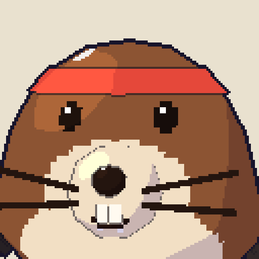
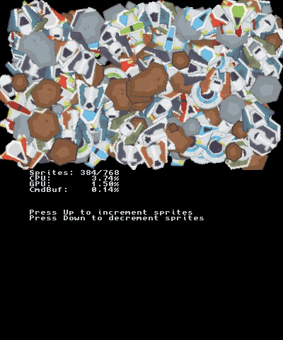
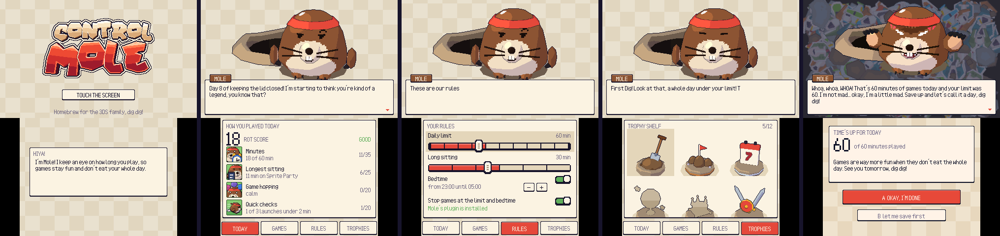

# ControlMole App | Promotion
<p align="center">
  <a href="https://controlmole.app/"></a>
</p>
<p align="center">
  Heads up, the mod also exists as an app for your phone for both Android and IOS ᕙ(  •̀ ᗜ •́  )ᕗ 
<p align="center">
  <a href="https://controlmole.app/play"></a>
  &nbsp;
  <a href="https://controlmole.app/appstore"></a>
</p>

# ControlMole for 3DS

A homebrew version of [ControlMole](https://controlmole.app) for the Nintendo 3DS. Mole keeps an eye on how long you play: you set a daily limit and a bedtime, and when time's up he pops out of his molehill over your game and tells you to call it a day.





There are two parts:

- **The app** (`ControlMole.3dsx` / `ControlMole.cia`) shows Mole on the top screen and has five tabs on the touch screen. Today has your score for the day, Games lists what you played and whether each game counts, Rules holds the limits, Trophies has the shelf of trophies you can earn by staying under your limit, and Dress Up lets you dress Mole like in the phone app.
- **The plugin** (`ControlMole.3gx`) is a Luma3DS game plugin that runs inside every game. It counts the minutes you play, warns you five minutes before the limit, and pauses the game once you hit the limit or your bedtime. From there you can press A to close the game, B to get one 3-minute break a day so you can save, or X to keep the game paused under Mole so you can close the lid and carry on from the same spot tomorrow (or at 05:00 after a bedtime).

You need a 3DS with [Luma3DS](https://github.com/LumaTeam/Luma3DS) installed.

## Installing

1. Install `ControlMole.cia` with FBI, or put `ControlMole.3dsx` in `sdmc:/3ds/` and run it from the Homebrew Launcher.
2. Copy `ControlMole.3gx` to `sdmc:/luma/plugins/default.3gx`.
3. Open the Rosalina menu (L + Down + Select) and turn on the plugin loader.
4. If you want sound in the app, dump your DSP firmware with [DSP1](https://github.com/zoogie/DSP1) once.
5. Open ControlMole and set your rules.

It has to be named exactly `default.3gx` and sit straight in `sdmc:/luma/plugins/`, not in a folder of its own (if you copied it there as `ControlMole.3gx`, the app renames it for you when you open the Rules tab), and it needs a Luma3DS with the plugin loader (v13 or newer). The screen flashes blue when a game starts if the plugin loaded. If Mole never shows up, open the Rules tab in the app: it says when the plugin last ran and in which game.

The app and the plugin share their files in `sdmc:/3ds/ControlMole/`: `settings.ini` holds your rules, and `plays.log` gets a line for every play session.

## Dress up

In the Dress Up tab, Mole stands in his dressing room and tries on whatever you tap: a fur colour, a headband, a hat, something for his body (a cloak, overalls or the ghost costume) and an accessory. Most furs and headbands are prizes for trophies, like in the phone app, so a locked one shows a padlock and Mole tells you which trophy earns it, but you can still try it on. Every hat, outfit and costume is free to wear. He keeps the look everywhere, on the top screen, in the trophy dance and when he pops up in your games.

## Good to know

- **DS and GBA games aren't covered.** The 3DS boots a separate DS or GBA mode for those, and Luma plugins can't run there, so Mole can't count or stop them.
- **Built-in apps don't count.** System Settings, the Camera, Sound and the other built-in titles are left alone.
- **Homebrew is counted, but Mole can't always draw over it.** Homebrew apps don't draw the way retail games do, so in some of them the time still counts but he can't pop up.
- **One plugin per game.** Luma loads only one plugin into a game, so where another one runs (a cheat plugin, CTGP-7) Mole isn't there. Your time in it still counts from the Activity Log, and he steps in at the next game.
- If a game crashes or Mole acts up, `sdmc:/3ds/ControlMole/plugin.log` has a step-by-step trace. Attach it to an issue together with the game's name.

## Building

The build runs in Docker, so you don't need devkitPro installed:

```
./build.sh
```

That gives you `ControlMole.3dsx` and `plugin/ControlMole.3gx`. If [makerom](https://github.com/3DSGuy/Project_CTR) and [bannertool](https://github.com/carstene1ns/3ds-bannertool) are in `~/Tools` (or you point `MAKEROM` and `BANNERTOOL` at them), you get `ControlMole.cia` as well. `./build.sh clean` cleans up.

