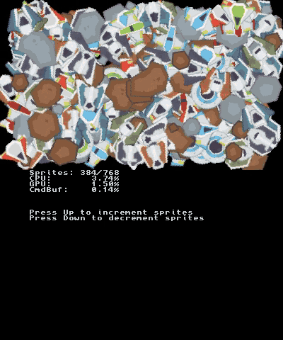
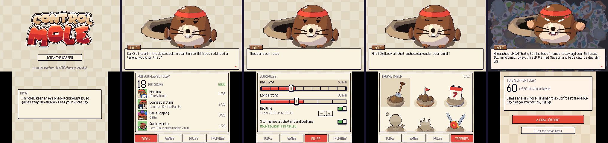

# ControlMole for 3DS

A homebrew version of [ControlMole](https://controlmole.app) for the Nintendo 3DS. Mole keeps an eye on how long you play: you set a daily limit and a bedtime, and when time's up he pops out of his molehill over your game and tells you to call it a day.





There are two parts:

- **The app** (`ControlMole.3dsx` / `ControlMole.cia`) shows Mole on the top screen and has four tabs on the touch screen. Today has your score for the day, Games lists what you played and whether each game counts, Rules holds the limits, and Trophies has the shelf of trophies you can earn by staying under your limit.
- **The plugin** (`ControlMole.3gx`) is a Luma3DS game plugin that runs inside every game. It counts the minutes you play, warns you five minutes before the limit, and pauses the game once you hit the limit or your bedtime. From there you can press A to close the game, or B to get one 3-minute break a day so you can save.

You need a 3DS with [Luma3DS](https://github.com/LumaTeam/Luma3DS) installed.

## Installing

1. Install `ControlMole.cia` with FBI, or put `ControlMole.3dsx` in `sdmc:/3ds/` and run it from the Homebrew Launcher.
2. Copy `ControlMole.3gx` to `sdmc:/luma/plugins/default.3gx`.
3. Open the Rosalina menu (L + Down + Select) and turn on the plugin loader.
4. If you want sound in the app, dump your DSP firmware with [DSP1](https://github.com/zoogie/DSP1) once.
5. Open ControlMole and set your rules.

The app and the plugin share their files in `sdmc:/3ds/ControlMole/`: `settings.ini` holds your rules, and `plays.log` gets a line for every play session.

## Building

The build runs in Docker, so you don't need devkitPro installed:

```
./build.sh
```

That gives you `ControlMole.3dsx` and `plugin/ControlMole.3gx`. If [makerom](https://github.com/3DSGuy/Project_CTR) and [bannertool](https://github.com/carstene1ns/3ds-bannertool) are in `~/Tools` (or you point `MAKEROM` and `BANNERTOOL` at them), you get `ControlMole.cia` as well. `./build.sh clean` cleans up.

## Status

So far it has only been tested in the [Azahar](https://azahar-emu.org) emulator. Reading play time from the 3DS Activity Log hasn't been tried on a real console yet, and when that doesn't work the app falls back to the plugin's own log. If you try it on hardware, I'd love to hear how it went.
